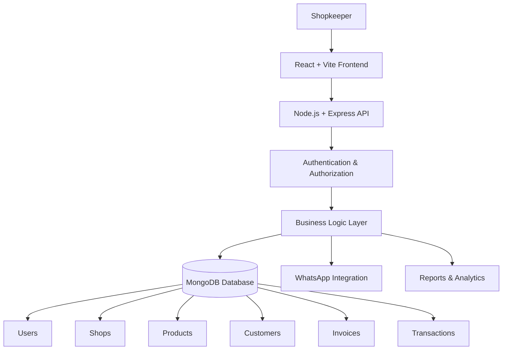

# 🛍️ Star Dukaan

  

<h3 align="center">Smart Business. Simple Management.</h3>

  

  A modern digital shop management platform designed to simplify everyday business operations for retailers and small businesses.

  
  
  
  

  <a href="#-about-the-project">About</a> •
  <a href="#-features">Features</a> •
  <a href="#-how-it-works">How It Works</a> •
  <a href="#-technology-stack">Tech Stack</a> •
  <a href="#-roadmap">Roadmap</a>

---

<!-- Add your actual banner image at docs/images/star-dukaan-banner.png -->

  

## 🌟 About the Project

**Star Dukaan** is a digital shop management platform being developed to help shopkeepers manage their everyday business operations from one organized place.

Traditional retail businesses often depend on paper records, manual calculations, separate registers, and scattered customer information. These methods can make daily operations time-consuming and difficult to organize.

Star Dukaan aims to simplify this experience by bringing essential shop management activities into a single digital platform.

From managing products and inventory to creating bills, maintaining customer records, and sharing invoices, the goal is to make business management easier, faster, and more accessible.

### 💡 Our Mission

To make digital business management accessible to everyday shopkeepers — without unnecessary complexity.

---

## 🎯 The Problem We're Solving

Many small and medium-sized businesses still face challenges with their daily operations.

| Common Business Challenges | Star Dukaan's Goal |
|---|---|
| Manual billing and calculations | Organized digital billing |
| Paper-based product records | Digital product management |
| Difficult stock tracking | Inventory management |
| Scattered customer information | Centralized customer records |
| Time-consuming invoice sharing | Convenient invoice sharing |
| Limited visibility into business activity | Business reports and insights |

Star Dukaan is being built to bring these workflows together in one place.

---

## ✨ Features

### 🧾 1. Smart Billing & Invoices

A streamlined billing experience designed to simplify everyday customer transactions.

- Create customer bills.
- Add products and quantities.
- Calculate bill totals.
- Generate organized invoices.
- Maintain transaction records.

### 📦 2. Product & Inventory Management

Keep product information and stock records organized.

- Add and manage products.
- Update product details and prices.
- Maintain available stock quantities.
- Track inventory changes.
- Organize product information.

### 👥 3. Customer Management

Build and maintain organized customer records.

- Store customer details.
- Manage contact information.
- Maintain purchase records.
- Access customer information conveniently.

### 💬 4. WhatsApp Invoice Sharing

Planned WhatsApp integration to make invoice communication easier.

- Share invoices with customers.
- Reduce manual communication.
- Improve the customer experience.

### ⭐ 5. Customer Feedback & Reviews

A planned feedback workflow to help shopkeepers understand customer experiences.

- Request customer feedback.
- Collect customer responses.
- Understand customer satisfaction.
- Improve customer relationships.

### 📊 6. Business Insights & Reports

Planned reporting capabilities to help shopkeepers understand business activity.

- Sales summaries.
- Transaction reports.
- Inventory insights.
- Business performance overview.

### 🔐 7. Shop-Wise Management

Designed around the idea that multiple shops should be able to manage their business data independently.

- Individual shop accounts.
- Shop-specific business records.
- Authentication and authorization.
- Protected access to business information.

> **Development note:** Star Dukaan is under active development. Features described as planned or in development should not be considered available until implemented and tested.

---

## ⚙️ How It Works

The intended workflow is designed to keep everyday shop operations simple.

  

1. **Create an Account** — A shopkeeper registers and sets up their shop.
2. **Add Products** — Product details, prices, and stock information are organized.
3. **Manage Customers** — Customer information is maintained digitally.
4. **Generate Bills** — Products and quantities are used to prepare invoices.
5. **Share Invoices** — Planned WhatsApp functionality helps share invoices.
6. **Review Business Activity** — Future reports and insights help understand business operations.

---

## 🖥️ Application Preview

  <b>Application Demo</b>

  

  <b>Dashboard Preview</b>

  

  <b>Responsive Mobile Experience</b>

  

> Screenshots and demo GIFs are visual placeholders until actual application captures are added to the repository.

---

## 🏪 Who Is Star Dukaan For?

Star Dukaan is being designed for different types of small and medium-sized retail businesses.

- Grocery and general stores.
- Clothing and fashion shops.
- Electronics stores.
- Mobile and accessories shops.
- Stationery stores.
- Hardware and home utility stores.
- Other independent retailers.

The long-term goal is to support different shop types through a flexible and easy-to-use platform.

---

## 🧠 System Architecture

The planned architecture separates the frontend, backend, authentication, and database responsibilities.

### Architecture Principles

- Separation of frontend and backend.
- Centralized server-side business logic.
- Authentication and authorization.
- Shop-wise data isolation.
- Server-side input validation.
- Secure handling of database credentials.
- Scalable API design.

> Architecture represents the intended system design. Actual implementation may evolve during development.

---

## 🛠️ Technology Stack

| Technology | Purpose | Status |
|---|---|---|
| React.js | User interface | Current frontend |
| Vite | Frontend tooling | Current frontend |
| JavaScript | Application logic | Current frontend |
| HTML5 | Page structure | Current frontend |
| CSS3 | Styling and responsive layouts | Current frontend |
| Node.js | Backend runtime | Planned / integration |
| Express.js | API development | Planned / integration |
| MongoDB | Business data storage | Planned / integration |
| Git | Version control | Development |
| GitHub | Source code hosting | Development |

---

## 🗺️ Development Roadmap

Star Dukaan is being developed step by step, with a focus on building a reliable foundation before expanding functionality.

### Phase 1 — Frontend Foundation

- [x] Initial website development
- [x] Brand identity and visual design
- [x] Responsive frontend layout
- [ ] Complete all application pages
- [ ] Finalize navigation and user experience

### Phase 2 — Core Business Features

- [ ] User registration and login
- [ ] Shopkeeper dashboard
- [ ] Product management
- [ ] Inventory management
- [ ] Customer management
- [ ] Billing and invoice generation

### Phase 3 — Backend & Database

- [ ] Node.js and Express API
- [ ] Database integration
- [ ] Authentication and authorization
- [ ] Shop-wise data isolation
- [ ] Server-side validation
- [ ] Error handling and logging

### Phase 4 — Business Integrations

- [ ] WhatsApp invoice sharing
- [ ] Customer feedback system
- [ ] Sales reports
- [ ] Inventory insights
- [ ] Business analytics

### Phase 5 — SaaS Platform

- [ ] Subscription plans
- [ ] Shop onboarding
- [ ] Multi-shop management
- [ ] Production deployment
- [ ] Monitoring and performance optimization

---

## 🔒 Security & Privacy

Security is an important part of the Star Dukaan development process, especially because the platform is intended to handle shop and customer information.

The planned security approach includes:

- Secure password hashing.
- Authentication and authorization.
- Shop-wise data access restrictions.
- Server-side request validation.
- Protected API endpoints.
- Database credentials stored outside frontend code.
- HTTPS for production communication.
- Rate limiting and abuse prevention.
- Careful handling of customer information.

Security controls will be implemented and tested as the backend develops.

---

## 🌱 Our Vision

We believe that every shopkeeper should have access to useful digital tools, regardless of the size of their business.

Star Dukaan aims to grow into a practical business management platform that helps retailers organize their daily operations, reduce manual work, and build better customer relationships.

We are building with a simple belief:

**Smart Business. Simple Management.**

---

## 🤝 Contributions

Star Dukaan is currently under development.

Suggestions, feedback, and ideas that can improve the platform are welcome.

If you find a bug or have a feature suggestion, you can open an issue in this repository.

---

 

---

## ⭐ Support the Project

If you find the idea interesting, consider giving this repository a star ⭐

Your support helps the project grow.

  

<h3 align="center">🛍️ Star Dukaan</h3>

<b>Smart Business. Simple Management.</b>

