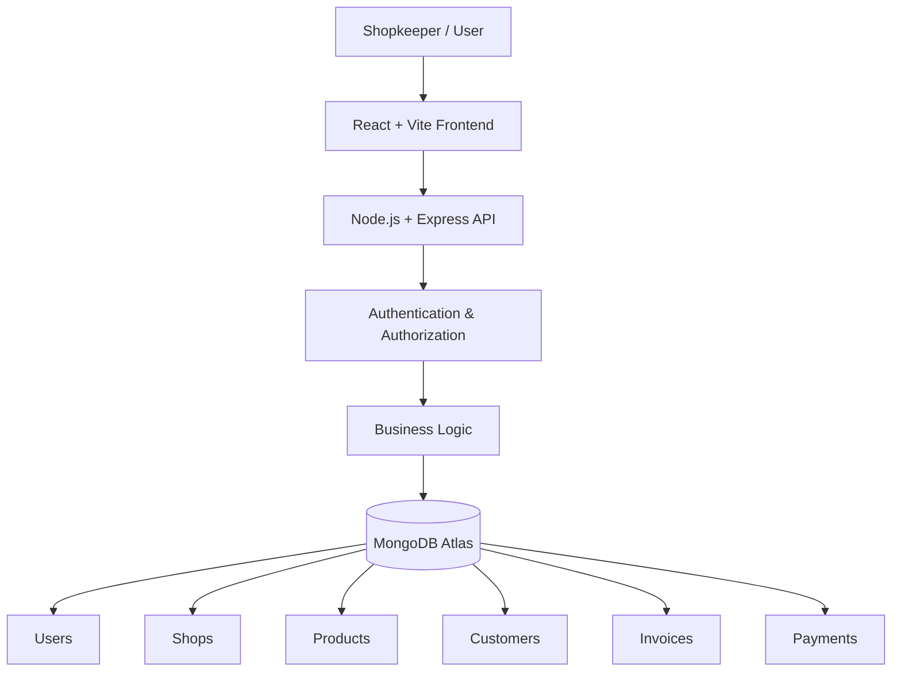

 # 🛍️ Star Dukaan

\

&#x20; \
\

\<h3 align="center">Smart Business. Simple Management.\</h3>

\

&#x20; \
\

\

&#x20; A modern shop management platform designed to simplify everyday business operations.
\

\

&#x20; \
&#x20; \
&#x20; \
\

---

## 🌟 About Star Dukaan

**Star Dukaan** is a digital shop management platform designed to help small and medium-sized shopkeepers manage their businesses more efficiently.

Running a shop involves many daily activities — managing products, tracking inventory, creating bills, maintaining customer records, and handling transactions.

Managing all these activities manually can be time-consuming and complicated.

Star Dukaan aims to bring these essential business operations together in one simple and organized platform.

\

&#x20; \
\

---

## 🎯 Why Star Dukaan?

| Traditional Shop Management | With Star Dukaan                 |
| --------------------------- | -------------------------------- |
| Manual billing              | Digital billing                  |
| Paper-based records         | Organized digital records        |
| Difficult stock tracking    | Product and inventory management |
| Scattered customer details  | Centralized customer records     |
| Manual feedback collection  | Digital feedback workflow        |

Our goal is to make digital business management simpler and more accessible.

---

## ✨ Core Features

### 🧾 Smart Billing

Create and manage customer invoices through an organized billing workflow.

- Product selection and quantity management.
- Automatic bill calculation.
- Invoice generation.
- Transaction record management.

### 📦 Product & Inventory Management

Keep product information organized.

- Add and update products.
- Manage product prices.
- Maintain stock quantities.
- Organize inventory records.

### 👥 Customer Management

Maintain customer information and organize purchase records.

- Customer profiles.
- Contact information.
- Purchase history.
- Customer record management.

### 💬 WhatsApp Invoice Sharing

Planned WhatsApp integration to make invoice sharing convenient.

- Share invoices with customers.
- Reduce paper-based communication.
- Improve customer convenience.

### ⭐ Customer Feedback & Reviews

A planned feedback workflow to help shopkeepers understand customer experiences.

- Send feedback requests.
- Collect customer responses.
- Review customer experiences.
- Improve customer relationships.

### 🔐 Secure Shop Management

Security-focused architecture for protecting shop and customer information.

- User authentication.
- Shop-wise data access.
- Protected API endpoints.
- Secure database access.

> Note: Features are being developed progressively. Planned integrations and functionality are not represented as completed features.

---

## ⚙️ How It Works

\

&#x20; \
\

1. **Register Your Shop** — Create an account and set up shop information.
2. **Add Products** — Organize products, prices, and stock.
3. **Create Bills** — Generate invoices for customer purchases.
4. **Manage Customers** — Maintain customer information and records.
5. **Share Invoices** — Use the planned WhatsApp integration.
6. **Collect Feedback** — Use the planned customer feedback system.

---

## 🖥️ Platform Preview

\

&#x20; \<strong>Star Dukaan — Application Demo\</strong>
\

\

&#x20; \
\

\

&#x20; \<strong>Dashboard Preview\</strong>
\

\

&#x20; \
\

\

&#x20; \<strong>Mobile Responsive Preview\</strong>
\

\

&#x20; \
\

---

## 🏪 Who Is It For?

Star Dukaan is designed for different types of retail businesses:

- Grocery and general stores.
- Clothing and fashion shops.
- Electronics stores.
- Mobile accessory shops.
- Stationery stores.
- Other small and medium-sized retailers.

---

## 🧠 System Architecture

The planned architecture separates the frontend, backend, and database to improve maintainability and security.

---

## 🛠️ Technology Stack

| Technology   | Purpose                               |
| ------------ | ------------------------------------- |
| React.js     | Frontend development                  |
| Vite         | Build tooling                         |
| JavaScript   | Application logic                     |
| HTML5        | Page structure                        |
| CSS3         | Styling and responsive design         |
| Node.js      | Backend runtime (planned/integration) |
| Express.js   | API development (planned/integration) |
| MongoDB      | Database (planned/integration)        |
| Git & GitHub | Version control                       |

---

## 🗺️ Development Roadmap

- [x] Initial website development
- [x] Responsive frontend layout
- [x] Initial branding and design
- [ ] User registration and authentication
- [ ] Shopkeeper dashboard
- [ ] Product management
- [ ] Inventory management
- [ ] Billing and invoice generation
- [ ] Customer management
- [ ] MongoDB database integration
- [ ] WhatsApp invoice sharing
- [ ] Customer feedback system
- [ ] Business analytics and reports
- [ ] Subscription plans

---

## 🔒 Security & Privacy

Star Dukaan aims to follow security best practices:

- Password hashing.
- Authentication and authorization.
- Shop-wise data isolation.
- Server-side request validation.
- Secure database credentials.
- Protected API endpoints.

Security measures will be implemented and verified as the backend develops.

---

## 🌱 Our Vision

We believe every shopkeeper deserves access to simple and useful digital tools.

Our vision is to build a platform that brings essential business operations together, reduces manual work, and helps shopkeepers manage their businesses with confidence.

**Star Dukaan — Making everyday business management simpler.**

---

## 👨‍💻 Founder & Developer

\

&#x20; \<strong>Ankit Choudhary\</strong>\ 
&#x20; Founder & Developer — Star Dukaan
\

\

&#x20; \<a href="[https://github.com/ankit16x2choudharytech-tech](https://github.com/ankit16x2choudharytech-tech)">
&#x20;   \
&#x20; \</a>
\

---

\
   \ \

\<h3 align="center">⭐ Star Dukaan\</h3> \
Smart Business. Simple Management.\

